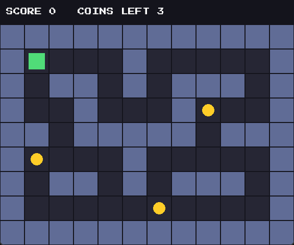

# GameTest


An automated test framework for a small 2D game. A C# test runner reads tests from JSON
files, launches the game, drives it through a built-in test agent, checks the result, and
writes a report. When a test fails, times out, or the game crashes, it saves a screenshot
and a log as evidence.

<p align="center"></p>

The game is only the test subject. The framework is the project.

## Features

- **JSON test definitions.** Tests are data, not code: `press`, `assert`, `wait_for`, `screenshot`.
- **Reliable checks.** The runner asks the game for its real state (scene, position, score,
  coins left) instead of guessing from pixels.
- **Clear outcomes.** Every test ends as `PASS`, `FAIL` or `TIMEOUT`, with the failing
  step and the reason.
- **Failure evidence.** Automatic screenshot and log, linked from a machine-readable
  `report.json`.
- **Isolation.** Every test runs on a fresh game process. A failing or crashing test never
  stops the others.
- **Process safety.** Startup and per-step timeouts, crash detection, clean shutdown,
  and Ctrl+C handling that closes the running game.
- **Flaky-test detection.** Run the suite N times and see which tests change result.
- **Tested itself.** 45 C++ tests, 39 runner unit tests (against a fake game), and 10 game
  tests. CI builds and tests everything on every push.

## How it works

```
 tests/json/*.json                         results/run_<time>/
        |                                    report.json, logs, screenshots
        v                                              ^
 +-----------------+    JSON lines over    +-------------------+
 |  C# test runner | --------------------> |  C++ game         |
 |  (runner/)      |   127.0.0.1 (TCP)     |  + test agent     |
 |                 |   ping, key,          |  (game/, agent/)  |
 |                 |   get_state, quit     |                   |
 +-----------------+ <-------------------- +-------------------+
```

The game opens a small TCP server only when started with `--agent-port N`, and it listens
on `127.0.0.1` only. Requests are handled on the game's own thread once per frame, so
when the runner gets a reply to a key press, the game has already processed that key.

## Quick start

Requirements: Windows 10/11, Visual Studio (or Build Tools) with the C++ workload,
[CMake](https://cmake.org/) 3.28+, [.NET SDK](https://dotnet.microsoft.com/) 10, and Git.
The first build downloads SFML, GoogleTest and nlohmann/json.

```powershell
git clone https://github.com/Prathudi/GameTest.git
cd GameTest
powershell -NoProfile -ExecutionPolicy Bypass -File scripts\build_and_test.ps1
```

This builds the game, runs the C++ tests, builds the runner and runs its unit tests. It
stops at the first failing step. The first run takes a few minutes while SFML builds.

To also run the real game tests (opens game windows; leave them alone while it runs):

```powershell
powershell -NoProfile -ExecutionPolicy Bypass -File scripts\build_and_test.ps1 -Full
```

To play the game: `.\build\game\Release\game.exe` (Enter starts, arrows move, Esc pauses).

## Running tests

```powershell
dotnet run --project runner\GameTest.Runner -c Release -- validate tests\json   # check test files
dotnet run --project runner\GameTest.Runner -c Release -- run-all tests\json    # run the suite
dotnet run --project runner\GameTest.Runner -c Release -- run-all tests\json --repeat 5
dotnet run --project runner\GameTest.Runner -c Release -- run tests\json\move_right.json
```

Example output (abbreviated):

```
[1/10] PASS    checkpoint_screenshots  (800 ms)
[2/10] PASS    coin_not_collected_twice  (291 ms)
...
10 run: 10 passed, 0 failed, 0 timed out  (11.6 s)
```

And for a failing test:

```
[1/2] FAIL    demo_fail_wrong_score  (117 ms)
[2/2] TIMEOUT demo_timeout_never_paused  (1114 ms)

Not passed:
  FAIL    demo_fail_wrong_score
      step 4: assertion failed: score expected 5 but was 0
      screenshot: results\run_...\demo_fail_wrong_score\demo_fail_wrong_score_FAIL_092406.png
      log:        results\run_...\demo_fail_wrong_score\demo_fail_wrong_score.log
  TIMEOUT demo_timeout_never_paused
      step 2: wait_for timed out after 1000 ms; wanted scene=paused; last state: scene=playing ...
```

| Exit code | Meaning |
|-----------|---------|
| 0 | every test passed |
| 1 | at least one test failed or timed out |
| 2 | setup problem (bad test file, game not found) |
| 130 | stopped with Ctrl+C |

`tests\json` is the regression suite and should always pass. `tests\demo` holds one test
that fails on purpose and one that times out on purpose, to prove failure handling works;
running it is expected to exit with 1.

## Writing a test

```json
{
  "name": "move_right",
  "timeout_ms": 15000,
  "steps": [
    { "action": "assert", "expect": { "scene": "main_menu" } },
    { "action": "press", "key": "Enter" },
    { "action": "wait_for", "expect": { "scene": "playing" }, "timeout_ms": 2000 },
    { "action": "press", "key": "Right" },
    { "action": "assert", "expect": { "player": { "x": 2, "y": 1 }, "score": 0 } }
  ]
}
```

| Action | What it does |
|--------|--------------|
| `press` | sends `key` or a list of `keys` (`Up`, `Down`, `Left`, `Right`, `Enter`, `Escape`) |
| `assert` | checks the state now; a wrong value is a **FAIL** |
| `wait_for` | polls the state until it matches; never matching is a **TIMEOUT** |
| `screenshot` | saves a picture of the game window; never fails the test |

`expect` can check `scene` (`main_menu`, `playing`, `paused`), `player` (`x`, `y`, or both),
`score` and `coins_remaining`. Only the fields you write are checked. Coordinates start at
(0,0) in the top-left corner; the player starts at (1,1) and the coins are at (8,3), (1,5)
and (6,7). Files are validated strictly when loaded, so a typo such as `"timout_ms"` is an
error and never silently ignored.

## Reports

Each run writes its own folder (ignored by git):

```
results\run_20261024_092404\
    report.json
    demo_fail_wrong_score\
        demo_fail_wrong_score.log
        demo_fail_wrong_score_FAIL_092406.png
```

`report.json` has the totals and, for each test, the outcome, duration, failure reason,
failed step, step log, and paths to its screenshot and log. If a screenshot could not be
taken (for example the game never started), the report says why. With `--repeat N`, a test
is called **flaky** only if it passed at least once and also did not pass at least once.

## Project layout

```
game/                          the game (core = rules, app = window and drawing)
agent/                         the test agent: JSON protocol, command queue, TCP server
runner/GameTest.Runner/        the C# test runner
runner/GameTest.Runner.Tests/  unit tests for the runner
tests/cpp/                     GoogleTest tests for the game and the agent
tests/json/                    the regression suite
tests/demo/                    tests that fail on purpose
tests/fake/                    fake games (crashing, hanging, flaky) for testing the runner
scripts/build_and_test.ps1     one command to build and test everything
```

## Design decisions

- **State, not pixels.** A screenshot cannot reliably answer "did the score go up?". The
  agent reports exact state; screenshots are evidence for people reading a failure.
- **A fresh game per test.** Tests cannot affect each other, and a crash ruins only one
  test. The price is a slower suite.
- **Polling instead of fixed sleeps.** `wait_for` checks every 50 ms, which is faster and
  less flaky than sleeping for a guessed time.
- **The runner depends on an interface** (`IGameClient`), so its logic is tested with a
  fake game: no windows, no processes.
- **Evidence is best-effort.** A failed screenshot is recorded and never replaces the
  test's real result.

## Limitations

- Windows only: screenshots use Windows APIs and need a visible, unlocked desktop.
- Keys are handed to the game through the agent, not injected by the operating system, so
  the path from keyboard to window is not tested. A production tool would add OS-level
  input injection.
- CI runs everything that needs no window (the build, the C++ tests, the runner tests). The
  game tests need a desktop, so run them locally with `-Full`.
- The tests use one fixed level, so coordinates are written into the JSON.
- There is no image comparison (screenshot diffing).

## License and credits

MIT, see `LICENSE`. Font: *Press Start 2P* by The Press Start 2P Project Authors, under
the SIL Open Font License 1.1 (see `assets/fonts/OFL.txt`).
